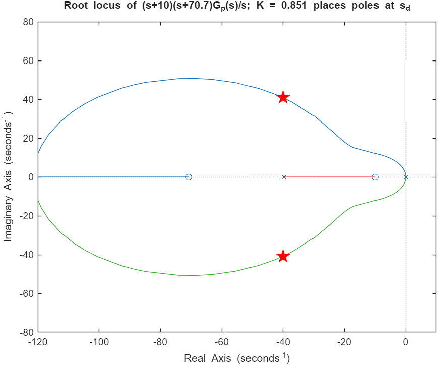
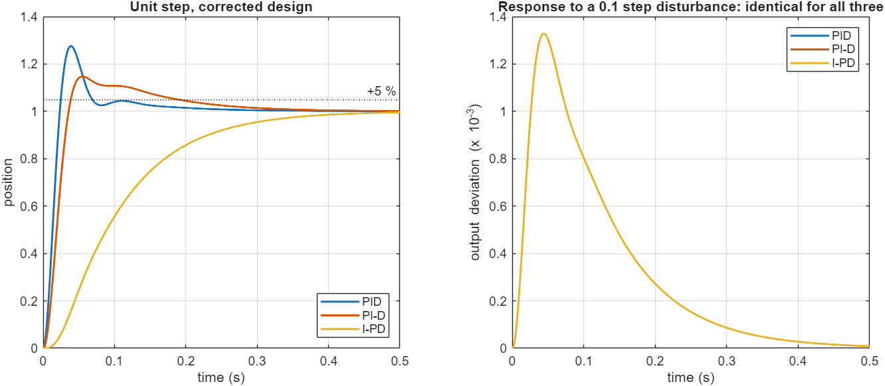
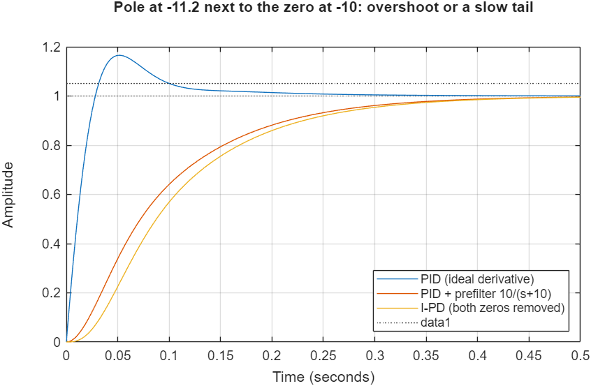
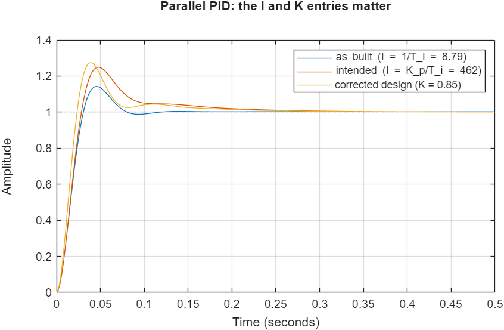

# PID Position Control of a DC Servo Motor: Root-Locus Design, PID vs. PI-D vs. I-PD

This project designs a PID controller by root locus for a servo motor and implements it in **MATLAB/Simulink** in three structures: **PID, PI-D and I-PD**. The structures are compared for set-point tracking and disturbance rejection.

> **Course:** Linear Control Systems Lab, final exam project, Amirkabir University of Technology, Spring 2025.

$$G_p(s)=\frac{60.5634}{s\,(s+39.6422)},\qquad t_s = 0.1\ \mathrm s,\quad PO<5\,\%,\quad \text{one PID zero at } s=-10$$

```matlab
>> run_all          % design, comparisons, figures in ./results (Control System Toolbox, Simulink)
```

## 1. Root-locus design (part a)
1. **Desired poles.** Settling time t_s = 4/(ζω_n) = 0.1 s gives σ = 40. An overshoot just below 5 % gives ζ = 0.70. So $s_d = -40 \pm j40.8$.
2. **Why the integral needs two zeros.** The locus of $G_p(s)/s$ (integral action alone) has three poles at or near the origin and never passes through s_d. The angle condition fails, so the PID's two zeros are needed: $G_c(s) = K\frac{(s+z_1)(s+z_2)}{s}$.
3. **First zero.** z₁ = 10, as specified.
4. **Second zero from the angle condition:** $\angle(s_d+z_1)+\angle(s_d+z_2)-\angle s_d-\angle G_p(s_d)$… gives **z₂ = 70.7**.
5. **Gain from the magnitude condition:** **K = 0.851**.
6. **Matching to** $K_p(1+\frac1{T_is}+T_ds)$: **K_p = K(z₁+z₂) = 68.7**, **T_i = (z₁+z₂)/(z₁z₂) = 0.114 s**, **T_d = 1/(z₁+z₂) = 0.0124 s**. In Simulink's parallel form this is P = 68.7, **I = K_p/T_i = 601**, D = K_p·T_d = 0.851.



With an ideal derivative, the closed-loop poles land exactly at −40 ± j40.8, so the design is verified. There is also a third pole at **−11.2**, next to the zero at −10.

## 2. Three controller structures
All three use the same gains. They differ only in **which signal the P and D terms act on**:

| Structure | Control law | Reference path |
|---|---|---|
| PID | $U = K_p(1+\frac{1}{T_is}+T_ds)\,E$ | both zeros (−10, −70.7) |
| PI-D | $U = K_p(1+\frac{1}{T_is})E - K_pT_ds\,Y$ | zero at −10 only |
| I-PD | $U = \frac{K_p}{T_is}E - K_p(1+T_ds)\,Y$ | no zeros |

In 2-DOF form, $U = C_r R - C_y Y$, all three have **the same feedback controller C_y**:
- They share the same closed-loop poles, the same stability margins and **identical disturbance rejection** (part h).
- They differ only in the zeros of the set-point response.



| Structure (corrected gains, N = 100) | Overshoot | Rise time | Settling time (2 %) | Peak response to a 0.1 disturbance step |
|---|---:|---:|---:|---:|
| PID | 27.5 % | 0.016 s | 0.170 s | 1.3 × 10⁻³ |
| PI-D | 14.7 % | 0.024 s | 0.270 s | 1.3 × 10⁻³ |
| I-PD | 0 % | 0.200 s | 0.371 s | 1.3 × 10⁻³ |

## 3. Why no structure meets both specifications
**The trade-off with z₁ = 10:**
- **Overshoot from the zeros.** Pole placement only fixes the two dominant poles. The closed-loop zeros at −10 and −70.7 are faster than s_d, so they add overshoot. Even with an ideal derivative, PID overshoots by 16.5 %.
- **A slow tail without them.** Removing the zero at −10 from the reference path (PI-D/I-PD, or a prefilter 10/(s+10)) removes the overshoot. But it exposes the slow closed-loop pole at −11.2, so settling takes about 0.36 s.
- **The cause.** With z₁ = 10 there is always either overshoot or a slow tail; the specification cannot be met in any of the three structures. Moving z₁ (for example, cancelling the plant pole at −39.6) would be the next design iteration.



**Derivative filter.** Simulink's filtered derivative with N = 100 puts a pole at −100, only about 1.7 × |s_d| away. That moves the dominant poles to −45 ± j80 and raises the PID overshoot from 16.5 % to 27.5 %. The filter pole should be about 10× faster than the dominant poles (N ≥ 600).

## 4. Discussion (parts d, f, g, h)
- **PI-D vs. PID.**
  - The derivative acts on the measurement, so a step in the reference no longer produces a derivative "kick" (an impulse in u).
  - Overshoot drops from 27.5 % to 14.7 %, and the control effort is smoother.
  - The cost is a slower rise. Disturbance rejection is unchanged.
- **I-PD vs. PID.**
  - Only the integral sees the error, so the reference enters through a pure integrator. There are no zeros, no overshoot, and (as standard theory predicts) the gentlest control action.
  - The cost is a much slower response (about 0.2 s rise and 0.37 s settling). Disturbance rejection is again identical.
- **Recommendation for servo positioning.** **I-PD**, where overshoot is unacceptable (a mechanism hitting an end stop, or machining); otherwise **PI-D**. Plain PID is the worst choice for step set-points: it reacts fastest but has the largest overshoot and derivative kick.
- **With a 0.1 step disturbance (part h).** All three give exactly the same response: a 1.3 × 10⁻³ peak deviation removed by the integral action, i.e. zero steady-state error. The structure choice only shapes the set-point response.

## Changes compared with the original exam submission
- **Integral gain.** In the Simulink PID block (parallel form P + I/s + D·s), the integral gain was entered as **I = 8.79**, which is 1/T_i. It should be K_p/T_i ≈ 462 (with the original K_p). The "PID" curve in the original report (14 % overshoot) was therefore effectively a PD controller with a very weak integral term. [`run_all.m`](run_all.m) reproduces that curve from transfer functions (14.3 %), together with the original PI-D curve (18.6 %), which confirms the diagnosis.
- **Loop gain.** The magnitude condition was evaluated with K = 0.637 instead of 0.851, so K_p was 52.6 instead of 68.7.
- **Comparisons.** Because of the integral-gain error, the PID branch and the PI-D/I-PD branches used *different* feedback controllers, so their comparison was not like for like. They are now compared with identical gains, and the disturbance case (part h) is included.



## Files
```
run_all.m                          design, simulations, tables, figures
simulink/servo_pid_original.slx    original Simulink model (PID, PI-D and I-PD branches)
results/                           figures
```

## Skills
Root-locus design · PID tuning and 2-DOF controller structures (PI-D, I-PD) · closed-loop pole-zero analysis · MATLAB Control System Toolbox and Simulink

## Author
**Sepehr Ebrahimi**, B.Sc. Electrical Engineering, Amirkabir University of Technology (2026)
